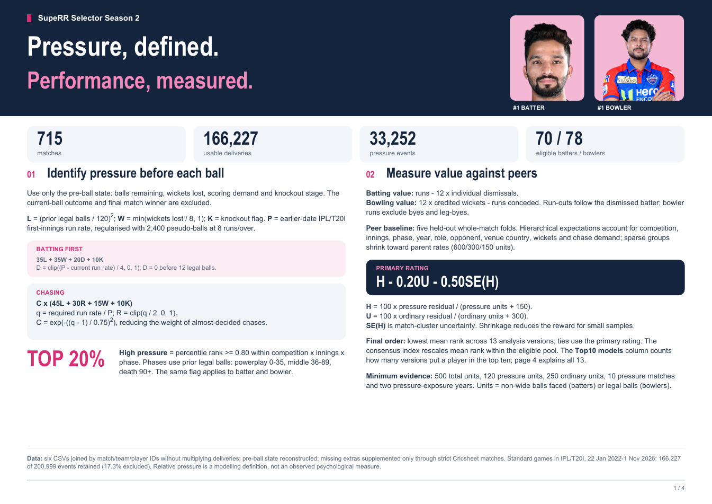

# SupeRR Selector Season 2

IPL and T20I pressure-performance analysis, a five-page methodology report, and an interactive Rajasthan Royals themed dashboard.

## Deploy on Netlify

1. Import this GitHub repository into Netlify.
2. Keep the repository root as the base directory.
3. Netlify reads `netlify.toml`: **publish directory `superr-dashboard/dist`**, **no build command**.
4. Deploy, then set the project name to choose an available `*.netlify.app` address.

The dashboard is already built. Deployment needs no Python, Node packages, API keys or environment variables. Only the contents of the publish directory are served; research datasets and scripts stay outside the website.

## Dashboard

- Scroll-driven 3D card stack for the top 10 batters and top 10 bowlers, with portraits, statistics and conditional RR role fit.
- Searchable top-20 comparison, highlighted final selections and sensitivity/bootstrap evidence.
- Pressure and metric definitions, including **13/13 checks = top-ten selection in all 13 analysis versions**.
- Revised methodology PDF, selection audit and final ranking CSV downloads.
- Responsive layout, keyboard navigation and a static-card fallback for reduced motion.

Run locally:

```bash
python -m http.server 8080 --directory superr-dashboard/dist
```

Open `http://localhost:8080`.

## Project files

| Path | Contents |
| --- | --- |
| `superr-dashboard/dist/` | Complete website: HTML, CSS, JavaScript, player data, portraits and downloads |
| `competition_data/` | Original six-file data pack and problem statement |
| `cleaned_competition_data/` | Cleaned dimensions, merged deliveries, data dictionary and cleaning audit |
| `pressure_analysis/` | Pre-ball match context, reference alignment, pressure features, exclusions and Cricsheet archives/notices |
| `final_analysis/` | Rankings, 13-setting comparisons, bootstrap summaries, holdout diagnostics and player evidence |
| `assets/portraits/` | Original report portraits and source manifest |
| `output/pdf/` | Revised submission and full top-20 selection audit |
| `docs/` | Dashboard and report previews |
| Root Python scripts | Complete cleaning, context, analysis, verification and PDF-generation code |

Seven large CSVs are stored as **lossless `.csv.gz` archives** to fit GitHub's file limits. `data_manifest.json` records each original path, byte count and SHA-256 checksum. The dashboard uses its own small data snapshot and does not need extraction.

## Reproduce the analysis

Python 3.10+ is required. Install the dependencies and restore the datasets:

```bash
python -m pip install -r requirements.txt
python restore_datasets.py
```

To verify the compressed data without extracting it:

```bash
python restore_datasets.py --verify-only
```

Run these from the repository root, in order, to rebuild the analysis:

```bash
python clean_competition_data.py
python build_pressure_context.py
python final_player_analysis.py
python verify_final_analysis.py
```

`profile_reference_alignment.py` is the separate reference-alignment diagnostic. Cached Cricsheet ZIPs and their attribution/license notices are included under `pressure_analysis/`.

The final dashboard snapshot and submission PDFs are committed. To regenerate the reports on Windows with Arial and Arial Narrow installed:

```bash
python create_selection_audit_pdf.py
python redesign_submission.py
```

`redesign_submission.py` reuses the original report generator, preserves both ranking-table layouts, and writes `output/pdf/SupeRR_Selector_Submission_Revised.pdf`. To update the downloadable report after regeneration, copy that file to `superr-dashboard/dist/methodology.pdf`. Rebuilding analysis outputs does not automatically rewrite the website's frozen `data.json` snapshot.

## Method and interpretation

The supplied 200,999 events were joined to player, team and match context. After verified extras supplementation and exclusions, the final model uses **166,227 deliveries from 715 matches**. High pressure is the highest fifth of pre-ball pressure within competition, innings and phase.

Players are compared against held-out peer expectations, with sample shrinkage and match-level uncertainty. Final rank is mean rank across **one baseline plus twelve assumption changes**. The top-ten-check count measures sensitivity to those assumptions; it is not a success probability and does not determine the ordering alone.

The 2026 holdout showed weak persistence: batting rank correlation **-0.374** and bowling **-0.039**. The rankings describe historical evidence, not a validated 2027 forecast. Auction entry, releases, clearances, current fitness, budget and overseas balance need separate verification. This is an independent competition submission, not an official Rajasthan Royals website.

## Supplemental uncapped watchlist

Ten provisional uncapped-Indian scouting candidates are included in a third card category, with photos, evidence tiers and conditional RR roles. The order uses the existing discipline-relative indices; no India playing-XI appearances are recorded in the supplied dataset. Complete senior cap histories and current availability require verification. This supplement does not alter the two required top-ten lists. Rebuild its data with `python update_uncapped_watchlist.py`; append its report page with `python append_watchlist_report.py` after regenerating the original revised report.

## Reports

The website also includes an **Auction Watchlist** after Method in the navigation. Its six profiles are conditional scouting options, not verified free agents or confirmed 2027 auction entrants. Each includes pressure evidence, a role hypothesis and a recruitment concern. Sources and the verification date are published in the section and `auction_watchlist_sources.json`. Regenerate its static content with `python build_auction_watchlist.py`; do not mark any candidate available without an official release/contract check and auction-shortlist verification.

- [Current five-page submission](output/pdf/SupeRR_Selector_Submission_With_Watchlist.pdf)
- [Top-20 selection audit](output/pdf/RR_Pressure_Player_Selection_Audit.pdf)
- [Full methodology and conclusions](final_analysis/METHODOLOGY_AND_CONCLUSIONS.md)



## Source credits

Competition data retains its supplied provenance. Supplementary match data is from [Cricsheet](https://cricsheet.org/) under [ODC-By v1.0](https://opendatacommons.org/licenses/by/1-0/); the original notices and attribution are included. Portrait ownership remains with the linked providers; individual image and profile URLs are in `assets/portraits/verified_official_photos.json` and in the dashboard footer. Historical team kits do not establish 2027 affiliation. This repository does not grant a new license over third-party images or competition data.
